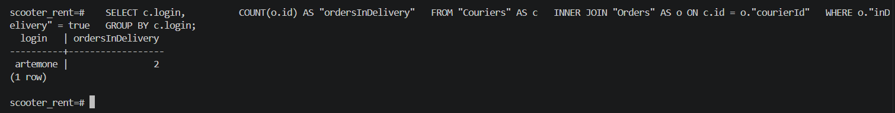
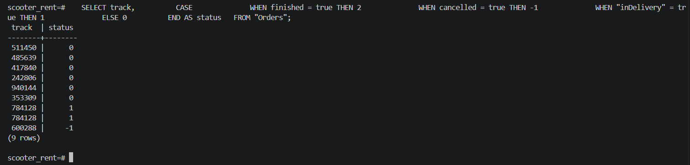
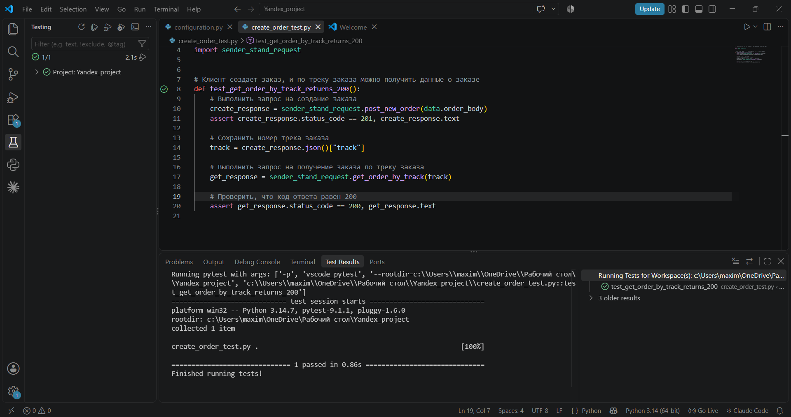

# Финальный проект: Яндекс Самокат

Артём Дмитриев, 49 когорта. Инженер по тестированию плюс.

В репозитории две части финального проекта:

1. SQL-запросы к базе данных сервиса.
2. Автотест к API: создание заказа и получение заказа по треку.

## Автотест к API

### Сценарий

Клиент создает заказ, и по треку заказа можно получить данные о заказе.

Шаги автотеста:

1. Выполнить запрос на создание заказа: `POST /api/v1/orders`.
2. Сохранить номер трека заказа из ответа.
3. Выполнить запрос на получение заказа по треку: `GET /api/v1/orders/track?t=<трек>`.
4. Проверить, что код ответа равен 200.

### Структура проекта

| Файл | Что в нем |
|---|---|
| `configuration.py` | адрес тестового стенда и пути к ручкам API |
| `data.py` | заголовки и тело запроса на создание заказа |
| `sender_stand_request.py` | функции для отправки запросов к API |
| `create_order_test.py` | автотест |
| `queries.sql` | SQL-запросы к базе данных |
| `requirements.txt` | библиотеки, нужные для запуска |

### Как запустить

1. Запустить сервер на платформе Яндекс Практикума. Нужен *запущенный* сервер.
2. Заменить адрес в `URL_SERVICE` в файле `configuration.py` на адрес своего стенда (без "/" в конце).
3. Установить библиотеки `requests` и `pytest`:

   ```
   pip install -r requirements.txt
   ```

4. Запустить тест из папки проекта:

   ```
   pytest -v
   ```

   или кнопкой **Run** в IDE.

Если на стороне сервера возникнет ошибка, логи лежат в файле `/var/www/backend/logs/error.log`.

## Работа с базой данных

Подключение к базе на стенде:

```
ssh <id стенда>@serverhub.praktikum-services.ru -p 4554
psql -U morty -d scooter_rent
```

Пароль: `smith`. Таблицы, названия которых начинаются с большой буквы, в запросах берутся в кавычки: `"Orders"`, `"Couriers"`.

### Задание 1

Логины курьеров и количество их заказов в статусе "В доставке" (`inDelivery = true`):

```sql
SELECT c.login,
       COUNT(o.id) AS "ordersInDelivery"
FROM "Couriers" AS c
INNER JOIN "Orders" AS o ON c.id = o."courierId"
WHERE o."inDelivery" = true
GROUP BY c.login;
```

### Задание 2

Трекеры всех заказов и их статусы: `finished = true` → 2, `cancelled = true` → -1, `inDelivery = true` → 1, остальные → 0.

```sql
SELECT track,
       CASE
           WHEN finished = true THEN 2
           WHEN cancelled = true THEN -1
           WHEN "inDelivery" = true THEN 1
           ELSE 0
       END AS status
FROM "Orders";
```

## Скриншоты

Результат задания 1:



Результат задания 2:



Успешный запуск автотеста:


